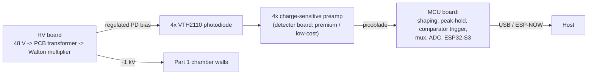
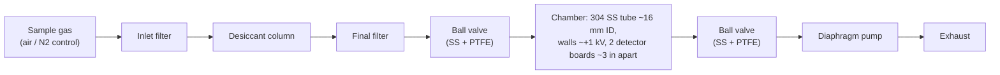

# Requirements: radon detection prototype

**Status:** DRAFT 2, Phase 1 (requirements). Not yet confirmed by the user.
**Started:** 2026-10-12. **Revised:** 2026-10-12 after the user's answers to Q-01 to Q-19.
**Legend:** `TBD (Q-xx)` means the target depends on an open question in §6. `VERIFY` means not yet checked against a source. `PROPOSED` means Claude's suggestion for the user to accept or change. Decisions are recorded in `decisions.md` (D-xx).

## 1. Purpose and scope

Build a two-part prototype for measuring alpha particles with silicon photodiodes:

- **Part 1: radon in air.** Sample gas passes through a filter, desiccant column and second filter into a small stainless-steel chamber. Chamber walls are held at about +1 kV so that positively charged radon-progeny ions (Po-218 and Po-214) are drawn onto the photodiodes.
- **Part 2: weld-sample alpha detection in rough vacuum.** The same detector board, with weld samples placed close to the detectors for direct alpha strikes. No HV, no ion steering. The aim is to find contamination that would matter for low-background scientific apparatus.

In each chamber, two detector boards run side by side (one premium, one low-cost) so the comparison is made on the same radiation field. **The comparison metric is whether the low-cost board gives similar information: event type and event frequency, i.e. the same radiation readings.** A low-cost design that works could later be used in large numbers (the user mentions ~100 detectors in parallel).

Electronics in scope: detector board (two variants), MCU board, HV board, plus a test electrometer front-end (§4.7). Mechanical in scope: both chambers, gas train, board mounting and feedthroughs (D-04). Pump and valves are operated manually and are outside the electronics (D-12).

### Part 1 gas train (D-01 to D-03)

## 2. Boards

| Board | Function | Variants / qty |
|---|---|---|
| Detector | 4x VTH2110 (5 mm) in a square + 4x charge-sensitive preamps; pressure boundary of the chamber (O-ring sealed); 2 layers | **Premium** and **low-cost**; one of each per chamber, so 4 boards total |
| MCU | Pulse shaping, peak-hold, comparator trigger, channel mux, ADC, ESP32-S3 (USB, ESP-NOW option) | 1, external to the chambers |
| HV | 48 V in; 100–200 V via PCB transformer; Walton multiplier to ~1 kV; regulated PD bias | 1; fixed output, no adjustment |
| Electrometer front-end (test equipment) | Pico-amp leakage and capacitance measurements of bare and populated boards | 1, may move to the test-gear repo later |

Power: wall adapters only (Mean Well 48 V and 5 V).

## 3. Reference facts and preliminary estimates

Numbers marked `VERIFY` are standard figures or recalled values that must be checked against a source before they drive a design decision.

**Physics**
- Si pair-creation energy is about 3.6 eV per pair, so a 6 MeV alpha releases about 1.7 × 10⁶ pairs (about 270 fC). `VERIFY` in phase 2.
- Alpha energies in MeV (`VERIFY` against ENSDF): Po-218 6.00; Po-214 7.69; Po-210 5.30 (from long-lived Pb-210, half-life about 22 y, so it accumulates on surfaces and shows up as background); thoron chain Po-216 6.78 and Po-212 8.78, Bi-212 6.05 (36 %).
- Self-contamination: Pb-210 and Po-210 deposited by previous air runs stay on the photodiode and chamber. That is the reason for the N₂ control run (D-05).
- Rough vacuum energy loss (`VERIFY`): a 5.5 MeV alpha loses roughly 1 MeV per cm of air at atmospheric pressure, so about 10 keV per cm at 10 mbar. Over the 5–10 mm sample gap (D-19) the loss is about 100 keV at 100 mbar, 10 keV at 10 mbar, 1 keV at 1 mbar and about 10 eV at 10⁻² mbar, so anything at or below about 1–10 mbar is enough for R-09. The Edwards E2M8 reaches 1×10⁻³ mbar (D-24), about four orders of magnitude of margin.

**Sensitivity of the Part 1 chamber (preliminary, assumptions in bold, `VERIFY` all)**
- Volume of a 21–22 mm bore tube (D-22), boards 76 mm apart: π × 1.05² × 7.6 ≈ 26 cm³ (21 mm) to π × 1.1² × 7.6 ≈ 29 cm³ (22 mm).
- At 100 Bq/m³ (0.1 Bq/L, a typical indoor level) the tube holds 0.1 × 0.026 ≈ 2.6 mBq of radon, which is about 9.5 radon decays per hour (about 10.4 at 22 mm).
- Each decay can give two alphas (Po-218, later Po-214). **If the overall collection and detection efficiency is 10–25 % per alpha**, the whole chamber sees roughly 2–5 counts/hour at 100 Bq/m³ and 0.2–0.5 counts/hour at 10 Bq/m³ (outdoor level). The efficiency is a guess and is the thing the field simulation must tell us.
- Consequence: for a 10 % statistical uncertainty (100 counts), indoor air takes of order days and outdoor air weeks. That fits the user's "hours/days, week+ for calibration" plan, but it makes the chamber a low-sensitivity instrument at ambient levels and a good one at mine levels (higher radon). It is not a blocker for the detector comparison, which compares boards against each other, but it sets expectations.

**Water load on the desiccant** (for the later characterisation, not a design driver, D-13)
- Saturated vapour density of air at 20 °C is about 17.3 g/m³, so 50 % RH holds about 8.65 g/m³. At 1 L/min (0.06 m³/h) that is 0.52 g/h, about 12.5 g per day. If the desiccant takes up about 10 % of its weight (`VERIFY` for the chosen product), that is about 125 g per day of continuous running. The N₂ control is already dry.
- Commercial radon monitors dry the sample and ask for low humidity at the detector (Durridge RAD7 uses Drierite, roughly 1 L/min; `VERIFY` from its manual) because water vapour reduces the fraction of Po-218 that stays charged.

**Parts** (datasheets not yet pulled)
- VTH2110: area, capacitance, dark current, rated bias (the user recalls 20 V as an option), which electrode faces the window. All `VERIFY`. The electrode polarity matters for ion steering, see R-47.
- ADS1220: 24-bit delta-sigma, up to 2 kSPS, has an input mux and single-cycle settling (`VERIFY`). Single-ended use gives half the code range (still about 23 bits).
- "ADS8689" as written by the user: `VERIFY` which part is meant. ADS8688 is, as far as Claude recalls, the 8-channel 16-bit SAR with a built-in mux; ADS8689 may be single-channel.
- **ADC resolution vs detector resolution (PROPOSED view):** a 16-bit ADC over 0–9 MeV has about 0.14 keV per code. Even 12 bits is about 2 keV per code. The photodiode and preamp resolution will be tens of keV, so ADC bits are not the limit; noise, droop and charge injection in the peak-hold are.

## 4. Requirements

IDs are provisional until the user confirms. Verification: **S** = simulation, **T** = test, **I** = inspection.

### 4.1 System

| ID | Statement | Target | Verify |
|---|---|---|---|
| R-01 | Part 1 detects alphas from radon progeny collected on the photodiode surface from a flowing or static sample | Sensitivity not specified. Expected levels: typical surface-level indoor/outdoor and underground-mine air. See §3 estimate | T |
| R-02 | Part 1 works with ambient air; bottled N₂ (semi-dry) is used as a control to check self-contamination between runs | Air and N₂ only | T |
| R-03 | Part 2 detects alphas from weld samples held close to the detectors in rough vacuum | ≤ 1 mbar target, ≤ 10 mbar acceptable (§3); E2M8 ultimate 1×10⁻³ mbar (D-24). Sample–detector 5–10 mm (D-19) | T |
| R-04 | One detector board design serves Part 1 and Part 2 | n/a | I, T |
| R-05 | In each chamber, one premium and one low-cost board run simultaneously, in the same field, about 3 in (76 mm) apart (Part 1) | Same arrangement in Part 2 | T |
| R-53 | Comparison metric: low-cost board reports similar event types and event frequency to the premium board | Quantitative criterion TBD (Q-07) | T |
| R-52 | Stable operation for long runs: hours to days regular, a week or more for calibration. Gain, baseline and leakage drift are within limits | Drift limits TBD, derived from R-09 | T |

### 4.2 Detector board (both variants)

| ID | Statement | Target | Verify |
|---|---|---|---|
| R-06 | Four VTH2110 (5 mm active, 5.67 mm die) photodiodes in a 2×2 array, each with its own charge-sensitive preamp | 4 channels, about 11.8 mm per side with 0.5 mm gaps, fits a 21–22 mm bore (R-39) | I |
| R-07 | Premium and low-cost variants share connector, pinout and mechanical interface so either can plug into the MCU board | Same | I |
| R-08 | Energy range covered | Radon chain 6.0–7.7 MeV; weld contamination may need roughly 4–9 MeV (Th/U chains) (Q-05) | S, T |
| R-09 | Energy resolution (FWHM) | PROPOSED ≤ 100 keV at ~5.5 MeV: separates Po-210 / Po-218 / Po-214 easily. Telling Bi-212 6.05, Rn-220 6.29 and Po-216 6.78 apart for thoron or weld work needs about this or better | S, T |
| R-10 | Low-cost variant uses standard footprints and general-purpose parts (the user estimates ~$4 vs ~$12 per amplifier), with no use of NC pins for guard or feedback. Premium variant may use dedicated CSP parts and their guard/feedback pins | Cost per channel TBD (Q-08) | I |
| R-11 | Works in vacuum (Part 2) and in the Part 1 gas: only the photodiode side is exposed; part choices avoid outgassing | Per R-03 | I, T |
| R-12 | Per-channel gain and noise are matched or characterised so channels can be compared | TBD | T |
| R-54 | The board is the pressure boundary: O-ring sealed to the chamber, photodiodes inside, back side at atmosphere with the connectors | Leak rate TBD; vias and board material are leak paths to check (Q-20) | I, T |
| R-55 | Two-layer board (lowest interlayer capacitance, simple circuit) | 2 layers | I |
| R-60 | Non-destructive test port per CSA input (electrometer R-19, D-02): a Murata SWF-type switched coaxial connector on the back side, in series between the diode node and the CSA input, shell on the 0 V guard ring; Ctest on the diode side. A populated, cleaned board is measured without soldering and goes into service after 1–2 mating cycles per connector. A dedicated bare-board test board uses the same footprints | SWF 2.5 × 2.5 mm, 100 cycles rated; fit on the ≤ 20 mm board (electrometer Q-13); CSA op-amp stable at noise gain 1 while its diode is disconnected | I, T |

### 4.3 MCU board

| ID | Statement | Target | Verify |
|---|---|---|---|
| R-13 | Per channel: pulse shaper, peak-hold (sample-and-hold) and a comparator. A comparator trigger interrupts the MCU, which routes that channel's held peak to the ADC, samples it, then clears only that channel | 4 channels; shaping time TBD (Q-04) | S, T |
| R-14 | Handles the expected event rate without losing events on other channels while one is converting | PROPOSED: no loss up to 100 events/s total (calibration source), far above radon rates; pile-up on one channel is detected and flagged | S, T |
| R-15 | Reports event energy code, channel and timestamp to the host over USB; ESP-NOW (PCB antenna) kept as a possible option | ESP32-S3 | T |
| R-16 | ADC choice by merit. ADS1220 (in stock) is the default; a 16-bit SAR with mux (ADS8688 or similar) is the alternative. A selectable high-resolution/high-rate path is optional | Options compared in phase 2; single-ended inputs are probably adequate for ground-referenced unipolar pulses | S |
| R-17 | The MCU board reads no chamber sensors (T, RH, pressure, flow) and applies no compensation (D-06) | None | I |
| R-56 | Board is external to the chambers; 2-layer if possible, 4 if needed | n/a | I |

### 4.4 HV board

| ID | Statement | Target | Verify |
|---|---|---|---|
| R-18 | Generates about +1 kV for the Part 1 chamber wall from a 48 V Mean Well supply, via PCB transformer (100–200 V) and Walton multiplier. Fixed output | Load current, accuracy TBD (Q-10) | S, T |
| R-19 | Output ripple and switching noise do not degrade the preamp noise floor | Limit derived from R-09 | S, T |
| R-20 | Regulated photodiode bias | Per VTH2110 datasheet (user recalls 20 V option, `VERIFY`); noise TBD | S, T |
| R-21 | HV construction: PCB for the low-voltage and transformer part; the high-voltage section built point-to-point (Manhattan or in-air) to avoid PCB surface leakage; epoxy-potted (vacuum and pressure pot) only after it is shown to work | Creepage/clearance margins TBD (Q-12) | I, T |
| R-22 | Nothing at HV is user-touchable. This includes the +1 kV chamber tube | Enclosure or insulation TBD (Q-12) | I |
| R-23 | HV output can be checked by the user (divider or test point) | TBD | T |

### 4.5 Interfaces, environment, build

| ID | Statement | Target | Verify |
|---|---|---|---|
| R-24 | Detector → MCU connection uses a Molex PicoBlade-style connector | Pin count and signals TBD in phase 2 | I |
| R-25 | Power inputs: Mean Well 48 V (HV board) and 5 V (other boards) | Rail details TBD | I |
| R-27 | Operating environment | Lab ambient; range TBD (Q-02) | T |
| R-28 | Prototype build: hand-assembled, 2-layer detector board | Smallest package, fab house TBD (Q-13) | I |

### 4.6 Mechanical and gas path

| ID | Statement | Target | Verify |
|---|---|---|---|
| R-29 | Part 1 gas train in the order of D-02, with a manual SS/PTFE ball valve on the chamber inlet and outlet | As drawn | I |
| R-30 | Everything upstream of the chamber avoids outgassing and radon-permeable materials (no silicone, rubber or PVC tubing). Tubing is PTFE | Drierite is the preferred desiccant; sourcing outstanding (Q-17) | I |
| R-31 | Closing both valves seals the chamber, so it can run static | Hold time TBD | T |
| R-32 | Gas-tightness: with the pump downstream the chamber is below ambient, so leaks draw in unfiltered, undried air | Characterise after build (D-13) | T |
| R-33 | Flow, pressure drop, desiccant service interval | Characterise after build (D-13) | T |
| R-34 | Humidity is measured at the outlet during purge with a manual sensor. No sensor is placed in the chamber or on the detector board (see §7) | Manual | I |
| R-37 | Filters remove aerosols and radon progeny from incoming gas, and stop desiccant dust | One standard filter for every gas port, PROPOSED in D-25; part selection open (Q-17) | T |
| R-38 | No conductive path from the +1 kV chamber to valves, tubing, pump or mounts: insulating PTFE gas-line sections between chamber and valves; creepage and clearance around the board's O-ring land and the photodiode corners | Distances TBD (Q-12) | I, S |
| R-39 | Chamber: 304 SS tube, walls at HV, four photodiodes on the detector board. **Decided 2026-10-12 (D-22): 3/4 in NPS pipe, bore 21–22 mm after grinding and lapping, possibly etched to remove contamination.** The VTH2110 die is 5.67 mm square (VTH2110.json p1): a 2×2 array with 0.5 mm gaps has a 16.75 mm diagonal, leaving about 2.1 mm (21 mm bore) to 2.6 mm (22 mm bore) from die corner to the wall. Uniform-field Paschen estimate for 2.1 mm at 100 mbar is about 1.46 kV (`VERIFY`; corners are worse), so R-43 still applies | Gap to wall confirmed by the field simulation; bore tolerance and etch recorded in the mechanical drawing | S, I |
| R-40 | Feedthroughs: detector signals pass through the board itself, which seals to the chamber. HV connects to the tube. Part 2 vacuum ports are standard | Details TBD (Q-18, Q-20) | I, T |
| R-41 | Pump vibration and drive noise (the pump is operated manually, outside the electronics) do not degrade the noise floor | Measured with the pump running | T |
| R-43 | HV is not applied to the chamber when it is below ambient pressure (inlet valve closed with pump running, or any pump-down). Procedure first; an optional hardware interlock decided in phase 2 | Claude's rough Paschen estimate (`VERIFY` in phase 2): a ~1 mm gap, such as a photodiode corner to the wall, can approach 1 kV near 100 mbar; the ~8 mm gaps are safe down to about 15 mbar | I |
| R-44 | Detector board mounts at each end of the tube with the photodiodes facing the sample volume; HV-side clearances per R-38 | Mount design TBD (Q-20) | I, S |
| R-46 | Part 2: custom aluminum chamber with gaskets, an NW25 port for the Edwards E2M8 two-stage rotary vane pump (D-24), an SS/PTFE ball valve, board O-ring sealed with its back at atmosphere. Weld samples close to the detectors | Pressure per R-03; gasket (Q-21), sample holder (Q-22) | I, T |
| R-57 | Part 2: pump oil does not reach the weld samples or the photodiodes. Pump only to a few ×10⁻² to 10⁻¹ mbar, not to ultimate (oil vapour backstreams in molecular flow); a foreline trap (activated alumina or molecular sieve) between chamber and pump; the chamber valve closed before the pump is stopped; venting with dry N₂ through the chamber inlet, never back through the pump line. The PTFE membrane filter (D-25) stops oil mist and particles but not oil vapour | Trap type and part TBD | I, T |
| R-58 | Part 2: counting can be done with the chamber sealed and the pump off, to remove pump vibration, motor EMI (R-41) and backstreaming. The allowed run length is set by the leak-up rate measured on the built chamber, up to about 1–10 mbar (R-03) | Leak-up rate measured after build (D-13) | T |
| R-59 | Part 2: a vacuum gauge (Pirani or similar) on an NW25 tee reads the chamber pressure | Gauge part TBD | I |
| R-47 | Photodiode surfaces are surrounded by exposed ENIG with a bias to push ions onto the photodiodes. Sign, magnitude and source decided by simulation. **Claude's view:** the ring should be slightly *positive* relative to the photodiode front surface (positive ions are repelled from it and steered to the diode). The source should be filtered or regulated, not raw 48 V, because noise on the ring couples capacitively into the preamp input | Set by simulation | S, T |

### 4.7 Test instrumentation and board characterisation

| ID | Statement | Target | Verify |
|---|---|---|---|
| R-48 | Bare-board characterisation before assembly: leakage between the input pad, guard and ring; interlayer and node capacitance | Limits from the preamp noise budget (phase 2) | T |
| R-49 | Populated-board characterisation: input leakage, input capacitance, gain via charge injection | TBD | T |
| R-50 | Electrometer front-end board (premium electrometer IC, switchable capacitors, reed relays, ESP32 over ESP-NOW) controlled by test scripts through the Raspberry Pi ESP-NOW bridge API (future). Until built, this section lives in this project; afterwards it is factored out into the test-gear repo | Requirements in `electrometer/docs/01-requirements.md` (DRAFT 1, 2026-10-20) | I, T |
| R-51 | Alpha source and HV measurement method | TBD (Q-14) | T |

## 5. Assumptions
- `PCB-WORKFLOW.md` applies (prototype boards, local inventory is a source of parts).
- The chamber is machined by the user; effort goes into building and then measuring, not into characterising everything in advance (D-13).
- Boards are separate KiCad projects sharing one project-local library.
- The electrometer is not SCPI. Until told otherwise, Claude will treat it like the bench instruments: write the script, show it, and have the user run it (Q-23).

## 6. Open questions

Resolved by the user on 2026-10-12: Q-01, Q-02, Q-08, Q-09, Q-10, Q-13, Q-16, Q-18 (partly), Q-19. See `decisions.md`.

- **Q-03** Resolved (2026-10-16): pump is an Edwards E2M8, ultimate 1×10⁻³ mbar (D-24); distance 5–10 mm (D-19). The pressure actually reached and the leak-up rate are measured with the gauge (R-59) after build. HV is not used in Part 2, so only the Part 1 pressure case (R-43) remains.
- **Q-04** Target sensitivity, and shaping time. The user does not know the target; decide after the first runs, or set a placeholder?
- **Q-05** Alphas of interest: radon chain, thoron chain, and the weld-contamination energy range? (Accept R-09 proposal?)
- **Q-06** Accept R-14 proposal (100 events/s total)? Expected weld-sample rates unknown.
- **Q-07** A quantitative "similar enough" criterion for R-53 (e.g. counts within X % over N days, peak positions within Y keV).
- **Q-11** Confirm the VTH2110 bias from the datasheet (needs pulling) and the electrode polarity.
- **Q-12** Creepage and clearance rule for 1 kV (to be proposed in phase 2: IEC 60664-1 or IPC-2221 tables, `VERIFY`), and how the +1 kV tube is made non-touchable.
- **Q-14** Alpha check source (e.g. Am-241)? Method of reading 1 kV (HV probe or divider)? Existing instrument limits to be checked in `instruments.json` in the test-plan phase.
- **Q-15** Suppliers and the path/format of `parts/inventory.csv`. Drierite sourcing is outstanding.
- **Q-17** Remaining gas-train details are deferred to after the build (D-13). Drierite availability to check.
- **Q-20** Detector board layout: are the preamps on the atmosphere side of the board (short vias from each photodiode) or on the chamber side? Board outline and O-ring land diameter. Are plated vias acceptable as the seal at rough vacuum?
- **Q-21** Gasket material for Part 2. Claude's input: Viton (FKM) is fine for a prototype. For low-background work the concerns are radon emanation and permeation, and U/Th in fillers; indium wire, PTFE or FEP-encapsulated O-rings are the usual lower-background choices, and screening a lot is the proper check (`VERIFY`).
- **Q-22** Weld sample size, holder, and distance to the detectors in Part 2.
- **Q-23** Confirm that the electrometer should be treated like the SCPI instruments (Claude does not operate it).

## 6b. Status after the user's second set of answers (2026-10-12)

- **Q-03 resolved:** sample-to-detector 5–10 mm; mid-level rotary pump (specs to come); purge with N₂ first to remove free radon, then pump down. HV is not used on the vacuum side. Pump pressure still to be read from its spec or a gauge.
- **Q-05, Q-06 accepted** (R-09, R-14 proposals). Radon in air is the primary target; the module PCB is fixed for it, and weld testing is best-effort (D-21).
- **Q-07 resolved as "LLM best effort"** (no metric until much more data; D-17).
- **Q-11 answered from the datasheet:** specs are at 20 V and 40 V reverse bias; breakdown > 100 V; no recommended operating point; polarity not stated. Default 20 V (VTH2110.json). The user's recollection of "20 V as an option" matches.
- **Q-12, Q-14:** kV tube enclosed in an outer touch-safe enclosure, trained staff only, possible NC discharge interlock; HV divider feeds the PWM controller; fire-alarm-type standards suggested (D-20). Still `VERIFY`.
- **Q-20 resolved:** preamps on the atmosphere side, filled and capped ENIG vias, circular board, O-ring size from the mechanical design; fallback is a vacuum-rated bulkhead connector with both sides under separate vacuum.
- **Q-21 resolved:** Viton, with "consider lower-background materials in future revisions".
- **Q-22 resolved:** coupons about 15 × 30 mm; vacuum chamber is a 50 mm ID cylinder (R-46).
- **Q-23 resolved:** the electrometer is scripted over the user's API that cascades to ESP-NOW; it streams data as events arrive. Treated like the bench instruments (Claude does not operate it).
- **Q-15, Q-17 unknown yet.**
- **New open questions:** **Q-24** ring bias sign: Claude's view is slightly positive relative to the diode front (to be confirmed by simulation and the diode polarity). **Q-25 resolved (D-22):** 21–22 mm bore. **Q-26** how to attach the four chips (wire bond vs conductive epoxy, ask Excelitas about carriers; architecture §3).

## 7. Notes on the answers

- **RH sensor on the detector board:** Claude recommends not putting one in the chamber. It is a ~15 cm³ volume, so a sensor body, its adsorbed water and any outgassing are large relative to it, it sits next to a 1 kV wall, and its I²C lines would be a noise path into the preamps. Use the outlet sensor during purge, as the user suggests.
- **Single-ended vs differential:** the held peaks are ground-referenced unipolar pulses, so four single-ended inputs are adequate. Differential helps for common-mode noise, which the layout and shielding should handle first.
- **Why the high-rate ADC may be unnecessary:** radon counts are ~1/hour in this chamber. Even a 2 ms conversion allows ~500/s. A fast path matters only for calibration with a strong source.

## 8. Verification coverage
Filled in at phase 4b (every `R-xx` mapped to S-xx, a `tests/NN-*` folder, or inspection).
