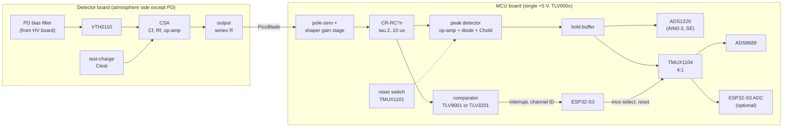

# Architecture: detector board and MCU board

**Status:** DRAFT 1, Phase 2 (architecture). **Gate not passed:** the user has not reviewed it. Written 2026-10-12 while the user was away, at their request to "proceed with the existing information" to a design spec with part numbers for the detector board and the MCU board. The workflow normally defers part numbers to phase 3, so §6 and `parts/selection.md` are a preview and every part stays a candidate until the user approves the topology. The HV board is not covered here. Revised the same day after the user's tube decision (D-22), the ADI datasheets they added, and their TLV900x preference (D-23).

Sources: `docs/01-requirements.md` (R-xx), `docs/decisions.md` (D-xx), datasheet JSONs in `datasheets/` (cited as `JSON p.N`), arithmetic in `sim/analytic/enc_budget.py` (output in `enc_budget.out.txt`). `VERIFY` means not checked against a source. Nothing here has been simulated yet.

## 1. Findings that change the plan

1. **Tube bore (resolved, D-22):** the VTH2110 die is 5.67 mm square (VTH2110.json p1), so a 2×2 array with 0.5 mm gaps has a 16.75 mm diagonal. The user chose a 3/4 in NPS pipe ground and lapped to 21–22 mm, leaving about 2.1 mm (21 mm) to 2.6 mm (22 mm) from die corner to the 1 kV wall. At 1 atm that is a small field (about 5 kV/cm average), but a uniform-field Paschen estimate gives only about 1.46 kV at 100 mbar for a 2.1 mm gap (`VERIFY`, corners are worse), so R-43 (no HV below ambient) stays. The field simulation should check the corners first. Chamber volume is now about 26–29 cm³, so the expected rate rises to about 2–5 counts/hour at 100 Bq/m³ (requirements §3).
2. **The detector datasheet does not say which electrode is on top.** It shows a bond pad on the top face and a conductive-epoxy die attach (VTH2110.json p1, p2). Which side is anode decides the bias polarity, the output pulse polarity and ion steering (R-47). A DMM diode test on a spare chip settles it before layout.
3. **The electronics' share of the energy resolution is small.** With a plain op-amp CSA the series noise gives roughly 5–14 keV FWHM depending on part and shaping time (§2.3). The target is 100 keV (R-09), and the detector's own dead layer, straggling and leakage will probably dominate. The premium module benchmark (Cremat CR-110) gives about 3 keV, so a premium amplifier may show no benefit in the spectrum. That is exactly the experiment you want to run, but the expected outcome is "similar" (R-53).
4. **Shaping time can be long.** Radon rates are about 1 count/hour (requirements §3), so shaping times of 4–10 µs cost nothing in pile-up and cut series noise. This is what allows a slow, cheap op-amp such as OPA140 (GBW 11 MHz).
5. **ADS8689 is single-channel, 100 kSPS** (ADS8689.json p1), so the mux is external. Its input is a constant resistive ≥ 1 MΩ, which would discharge a hold capacitor in milliseconds, so every hold node needs a buffer.
6. **Supply rails and the TLV90xx preference (D-23).** The TLV90xx parts are specified 1.8–5.5 V only (abs max 7 V for TLV9001, 6 V for TLV9061; TLV9001.json p14, TLV9061.json p10), so they cannot run from the ±4.5 V rails (9 V total) that the detector board's CSA op-amps use. The MCU board analog chain therefore runs on a single +5 V rail with the signal sitting on a baseline offset. In return they are rail-to-rail at input and output, which removes the +1 V input limit OPA140 would have had. **Which TLV90xx part:** the TLV9001 (1 MHz, 2 V/µs, 27 nV/√Hz, 5 pA bias, 1.2 kΩ open-loop output impedance) is adequate for the shaper but is marginal for the peak detector and hold buffer. The **TLV9061 family (10 MHz, 6.5 V/µs, 10 nV/√Hz, 0.5 pA, 100 Ω) is a much better fit for those stages at 9× the supply current** (0.54 mA per amplifier, irrelevant on a wall adapter) and keeps the standard (§2.5). The negative rail (LM27762) is then needed only by the detector board.

## 2. Signal chain and budget

### 2.1 Per-channel chain (×4 on each board, one set per detector board)

Sequence per event (R-13): comparator fires → ESP32 notes the channel and time → waits for the peak (about the peaking time; the hold keeps the value, so timing jitter does not matter) → selects that channel on the mux and starts a conversion → reads the code → pulses that channel's reset only. Other channels keep their own holds. A second trigger on the same channel before reset is counted (pulse counter peripheral) and flags the event as pile-up. ADS8689 holds time-critical dead time to tens of µs; ADS1220 is slower (about 1/data-rate, 0.5 ms at 2 kSPS, latency `VERIFY`), so it is the high-resolution, low-rate path (R-14, R-16).

### 2.2 Gain and levels (arithmetic)

- Charge per MeV in Si: 1 MeV / 3.62 eV × 1.602 × 10⁻¹⁹ C = 44.3 fC. 6.0 MeV = 266 fC, 7.69 MeV = 340 fC, 8.78 MeV = 389 fC.
- CSA with Cf = 1 pF: 44.3 mV per MeV, 389 mV at 8.78 MeV. Cf must be treated with care: board stray across a 1 pF part is about 0.1–0.3 pF (`VERIFY` by measurement), so the gain will differ by tens of percent from the nominal. **Calibration with the test-charge input (R-49) is mandatory; do not trust the nominal gain.**
- With rail-to-rail TLV900x on +5 V, the headroom is no longer the limit. **Nominal system gain 150 mV/MeV** (shaper gain about 3.4, to be trimmed in simulation since a CR-RC^n shaper peaks below its gain): 8.78 MeV → about 1.3 V above a baseline of roughly 0.2–0.3 V, which fits the ADS1220's 2.048 V range at gain 1 and uses 26 % of the ADS8689's 0–5.12 V range. A 1 MHz GBW limits each stage to a gain of about 5 or less at 100–200 kHz, so keep per-stage gain modest.
- **Baseline offset:** the shaper output rests at about 0.2–0.3 V so noise and undershoot do not clip at the rail (TLV9001 output swing is within 10–20 mV of the rail at 10 kΩ, p17). The peak hold captures baseline plus signal; the firmware subtracts a stored per-channel baseline. TLV9001 offset ±0.4 mV typical and ±1.6 mV maximum (p17) is 2.7–11 keV at 150 mV/MeV, so offsets are calibrated, not assumed zero.
- ADC resolution at 150 mV/MeV: ADS8689 on its 0–5.12 V range: LSB = 5.12 V / 65536 = 78 µV = 0.52 keV per code. ADS1220 at gain 1 on its 2.048 V reference, single-ended (half the code range, still about 23 bits): sub-eV per code. Both are far finer than the detector resolution (`VERIFY` ADS1220 single-ended input limits).
- Output DC offset of the CSA from dark current: I_dark × Rf = 0.15–2 nA × 100 MΩ = 15–200 mV (VTH2110.json p1, p3). The pole-zero/shaper stage on the MCU board AC-couples this away.
- Peak-hold droop budget: 0.03 % of about 1.3 V full scale = 0.4 mV over a 5 ms worst-case hold with Chold = 1 nF gives I ≤ 0.4 mV × 1 nF / 5 ms = 80 pA total leakage on the hold node. Candidates: TMUX1101 leakage 3 pA (TMUX1101.json p1), TLV9001 input bias ±5 pA typical (max not extracted, TLV9001.json p17), diode `VERIFY` (low-leakage type needed). Reset switch charge injection about −1.5 pC into 1 nF is about 1.5 mV offset after reset: constant, absorbed in baseline calibration.

### 2.3 Noise budget (from `sim/analytic/enc_budget.py`)

Inputs: C_pd 33 pF (spec < 30 pF at 20 V, curve about 32 pF; VTH2110.json p1, p3), 2 pF stray, Cf 1 pF, Rf 100 MΩ, CR-RC shaping with form factor 0.924 (`VERIFY`), 3.62 eV per pair (`VERIFY`), dark current 0.15 nA typical to 2 nA maximum. Op-amp Cin: OPA140 17 pF, OPA656 3 pF (from the datasheets); OPA657 and LMP7721 not extracted, 5 pF assumed.

| Op-amp (e_n) | tau 1 µs | 2 µs | 4 µs | 10 µs | CSA rise (10–90 %) |
|---|---|---|---|---|---|
| OPA140 (5.1 nV/√Hz) | 13.6 keV | 9.6 | 6.9–7.4 | 4.9–6.3 | about 1.7 µs |
| OPA656 (6.0) | 11.7 | 8.3 | 6.0–6.5 | 4.4–5.9 | about 60 ns |
| OPA657 (4.8, Cin assumed) | 9.8 | 7.0 | 5.1–5.7 | 3.9–5.5 | about 9 ns |
| LMP7721 (6.5, Cin assumed) | 13.3 | 9.5 | 6.8–7.3 | 4.8–6.2 | about 0.8 µs |
| ADA4817-1 (4.0, GBW ≥ 410 MHz) | 7.5 | 5.4 | 4.0 | 3.3 | about 31 ns |
| ADA4530-1 (14, 2 MHz; electrometer part) | 30.8 | 21.8 | 15.5 | 10.0 | about 7.5 µs |
| Cremat CR-110 module (benchmark) | about 2.8 keV (200 e + 3.8 e/pF × 33 pF, at 1 µs) | | | | 3 ns |

Values are FWHM in keV; ranges are typical to maximum leakage. The two ADI rows are typical-leakage values from the same script. **Downstream stages:** a TLV900x first stage at gain 1 (27 nV/√Hz, TLV9001.json p17) adds about 0.7 keV FWHM at 4 µs (0.44 keV at 10 µs), small in quadrature against 7 keV, and smaller still with first-stage gain. Series noise dominates; leakage shot noise and Rf noise are a minor part. Limits: the model ignores 1/f noise, assumes CR-RC rather than CR-RC^n, and ignores layout parasitics and the non-ideal op-amp. Expect real numbers of a few keV worse, `VERIFY` in phase 4 with `.noise` simulation. **For OPA140 the CSA rise time (1.7 µs) is shorter than a 4 µs shaping time, so ballistic deficit is a constant gain loss, not a resolution loss. Use tau ≥ 4 µs with OPA140.**

### 2.4 Why the Cremat module beats the op-amps (and whether it matters here)

There is no matching or calibration trick behind the Cremat figure as far as the public documents show (CR-110-R2.1.json p1 gives a measured, typical specification, not a calibrated one; I found nothing on per-unit trimming, and the internal input transistor is not disclosed). The difference is the input device:

- **Series noise is set by the input transistor's transconductance.** Cremat's ENC slope of 3.8 e/pF implies an input voltage noise of about 0.6–1.2 nV/√Hz, depending on what their "Gaussian shaping time constant" means (the datasheet does not define it and the "µ" is missing from the extracted text). The op-amps are at 4.0 nV/√Hz (ADA4817-1), 5.1 (OPA140) and 6.5 (LMP7721). That 4–8× gap is the whole story.
- **How a module gets there:** a large, high-gm discrete JFET (or several in parallel) as the first stage, biased at a few mA. Its gate capacitance is tens of pF, which a general-purpose op-amp avoids to stay fast and low-power (1.3 pF for ADA4817-1, 17 pF for OPA140), and power is spent freely (CR-110 is on ±6 V at about 85 mW, `VERIFY`). For a JFET, series noise is minimised when the input capacitance is of the order of the detector capacitance (a classic design rule, quoted in a BYU thesis found by search; designers sometimes depart from it for stray capacitance). Our diode is about 33 pF, so a JFET of 10–30 pF is the right size. This is the "component matching": choosing the input device size for the detector, not trimming parts.
- **Sanity check with our script (hypothetical row, `enc_budget.out.txt`):** a BF862-class JFET (NXP BF862, about 0.8 nV/√Hz and about 10 pF from a search snippet, datasheet not pulled, `VERIFY`) in front of a fast op-amp would give about 233 e (2.0 keV FWHM) at 1 µs with typical leakage, close to the module's roughly 325 e (2.8 keV). So the numbers are consistent with a JFET front end.
- **The limit is then the diode, not the amplifier:** with a JFET front end the series noise falls to 70–110 e at 4–10 µs, and the diode's own shot noise (dark current 0.15–2 nA gives 80–480 e) and the 100 MΩ feedback resistor (150–240 e) take over. The practical floor is about 2–3 keV FWHM (typical leakage) to about 5 keV (2 nA leakage).
- **Does it matter for the product?** The electronics only matter if they are comparable to the rest of the resolution. An alpha entering through a 150 nm dead layer (VTH2110.json p1) loses about 25 keV at normal incidence (about 160 keV/µm in Si, `VERIFY` with NIST ASTAR) and more at oblique angles, which is the usual case for ions plated on the surface. So the spectrum width will be tens of keV from the detector geometry whichever amplifier is used. A 7 keV op-amp amplifier and a 3 keV JFET amplifier add in quadrature to a 25–50 keV physical width as 26 vs 25 keV. They will not look different in the spectrum, so a JFET front end is worth building only as a bench noise reference, not as the product.
- **Options if you do want the premium noise:** (1) buy one Cremat CR-110-R2.1 as a reference channel; (2) add a discrete-JFET plus op-amp CSA to a single channel of a test board (BF862 or similar, datasheet and availability to check); (3) ADA4817-1 as the "off-the-shelf premium" (about 4 keV at 4 µs).

### 2.5 Does TLV90xx standardisation cost performance?

Assessed against the datasheets, not asserted:

| Stage | TLV9001 (1 MHz) | TLV9061 (10 MHz) | Verdict |
|---|---|---|---|
| Shaper (4 µs, gain ≤ 5 per stage) | Adequate: 27 nV/√Hz adds about 0.7 keV FWHM; GBW supports gain 5 at 200 kHz | Better in every spec | Either; TLV9001 acceptable |
| Peak detector driver | Marginal: 1.2 kΩ open-loop output impedance, 1 MHz GBW to track a crest into 1 nF | 100 Ω, 10 MHz, 6.5 V/µs | Use TLV9061; simulate |
| Hold buffer | 5 pA bias eats part of the 80 pA droop budget | 0.5 pA | Use TLV9061 |
| Comparator | Works (µs delay, harmless), poor timing | Works with about 1 µs delay | Either; TLV3201 only if pile-up counting at high rates matters |
| Charge amplifier on the detector board | **Not suitable** (27 nV/√Hz, 5 pF common-mode, 1 MHz GBW) and TLV9061 (10 nV/√Hz) is also worse than OPA140 (5.1) or ADA4817-1 (4) | | Do not use TLV90xx at the CSA |

So the standard does not diminish the product for the downstream stages as long as the TLV906x family is used where bandwidth and bias matter. The one place it would hurt is the CSA, which is the detector board and is kept separate. All three TLV parts have the same SOT-23-5 (and dual SOIC-8) footprints (TLV9061 SOT-23-5 pinout `VERIFY`), so the choice can be changed at assembly.

## 3. Detector board design spec (two variants: premium, low-cost)

**Role (R-06, R-07, R-54, R-55):** four VTH2110 photodiodes and four CSAs, circular two-layer PCB that is the pressure boundary: O-ring sealed to the chamber, photodiodes inside, preamps and connector on the atmosphere side (user answer, Q-20), signals through filled and capped vias with ENIG (D-14, Q-20). Output via a PicoBlade connector to the MCU board.

**Common to both variants**
- **PD mounting (assembly risk, decision needed):** die attach with conductive epoxy to a pad (back contact) plus a connection to the 0.4 mm top bond pad (VTH2110.json p1). Options: wire bond (needs a bonding-compatible finish; plain ENIG may not suit ultrasonic bonding, `VERIFY`), or a fine wire attached with conductive epoxy by hand. Ask for chips on a carrier from Excelitas ("assembled on a carrier", p1) if hand bonding is impractical.
- **Which node is the sensitive one:** put the CSA input on the small top bond pad and bias the large die-attach pad (low impedance), if the top face is the anode. If the diode is the other way, bias polarity and ion-steering polarity reverse and the large die-attach pad becomes the CSA input node, which is noisier (more area and capacitance). **Measure first.**
- **PD bias:** 20 V default. Datasheet specifies the dark current at 20 V and 40 V and gives breakdown > 100 V (VTH2110.json p1). Depletion is more than 90 µm at 20 V, and I estimate the alpha ranges in Si at about 30 µm (5.5 MeV) and 65 µm (8.8 MeV) (`VERIFY` with NIST ASTAR), so 20 V fully stops alphas inside the depletion layer. A higher bias lowers C (about 32 pF at 20 V to about 21 pF at 50 V, Fig 3 approximate) and so noise, but raises dark current. Per-board bias filter: RC low-pass (R about 1 MΩ, C about 100 nF, to be simulated) from the HV board's bias output; one bias for all four diodes with a resistor per diode so one leaky diode does not load the others.
- **CSA:** non-inverting input at 0 V, bipolar ±4.5 V analog rails, feedback Cf = 1 pF (C0G, tolerance and stray to be measured) in parallel with Rf = 100 MΩ (decay 100 µs; 1 GΩ would add up to 2 V of offset from dark current). Output has a series resistor for cable isolation (value TBD in simulation). Pulse polarity depends on diode polarity; the MCU board stage handles either (§4).
- **Test charge input (R-49):** per channel a small C0G injection capacitor (about 1 pF) from a common test line, so a pulse generator step of ΔV injects Q = Ctest × ΔV into the real input node. It adds about 1 pF to the input, which is acceptable at 33 pF.
- **Ring bias (R-47):** the exposed ENIG ring is driven from a filtered rail, polarity and value from the field simulation, never raw 48 V. It should be slightly positive relative to the diode front surface (my view, Q-24).
- **Guarding and layout (R-48):** the CSA input pad and trace are the critical node. Keep the trace short and straight, surround it with a guard trace tied to the non-inverting input potential (0 V) on the same layer, remove solder mask over the guarded trace if the fab permits (`VERIFY`), keep the input node off the board edge, and coat the atmosphere side in a way that does not add leakage. **Flux residue is a real leakage path:** the ADA4530-1 datasheet reports that flux residue degrades effective bias current and recommends RMA paste with an ultrasonic IPA clean and a 125 °C bake (about 15 min clean plus 1.5 h bake for RMA, much longer for no-clean paste; ADA4530-1.json p38). Hand-assemble the input nodes with RMA flux, clean, bake, and handle with gloves. Keep digital lines away from the input.
- **Humidity:** VTH2110 is rated to 60 % RH non-condensing (VTH2110.json p2). Keep spare chips in a dry box, and assemble in a dry condition.
- **Connector (PicoBlade, pin count ≤ 15 `VERIFY`):** proposed 14 pins: OUT1..4 each paired with a ground, +4.5 V, −4.5 V, GND, PD bias, ring bias, TEST. Final plan in phase 3.
- **Power:** ±4.5 V from the MCU board's LM27762 plus a local RC or ferrite filter and bulk C per board. LM27762 noise and PSRR are not extracted: `VERIFY` before relying on it for a CSA rail (LM27762.json not_extracted).

**Variants (R-10, R-53)**

| | Low-cost board | Premium board |
|---|---|---|
| CSA op-amp | Standard single 8-pin SOIC footprint (pins 1, 5 and 8 unconnected, so NC-pin and offset-null parts both fit). Default **OPA140** (user estimate about $4, not checked). Swap candidates: OPA656, OPA657 (datasheets pulled), TL071-class parts (not pulled) | **LMP7721** (user-reported price $8.40 each): 3 fA bias and a pinout whose NC pins separate the inputs for guarding (LMP7721.json p3; non-standard pinout, so a separate footprint). Considered and not chosen as default: **ADA4817-1** (4 nV/√Hz, 1.4 pF input, FB pin next to −IN, SOIC-8 hand-solderable; but 19 mA per amplifier, so about 0.7 W per board, and expensive per the user) and **ADA4530-1** (20 fA, guard pins on both sides of the inputs, but 14 nV/√Hz, 2 MHz and 8 pF make it a poor CSA, about 15 keV at 4 µs; keep it for the electrometer) |
| Layout | Guard by trace only | Guard using the NC pins and a tighter keep-out |
| Passives | Standard C0G/thick-film | Low-leakage choices where it matters (Cf, Rf) |
| Purpose | Find out how cheap the amplifier can be | Reference for what extra leakage control or noise buys |

**What the premium board can actually test.** The datasheet numbers split the premium idea in two: the *leakage* hypothesis (LMP7721, ADA4530-1: fA bias, guard pins) is irrelevant while the diode's own dark current (0.15–2 nA) is about 10⁴ times larger than 3–20 fA, so only board surface leakage could matter. The *noise* hypothesis (ADA4817-1, about 4 keV vs 7 keV at 4 µs) is the one with a visible effect on peak width, but at a power and price cost. If a single premium option is wanted for the comparison, ADA4817-1 gives the information-rich answer and LMP7721 gives the affordable one; the cheapest informative step is to buy one or two ADA4817-1 for a single-channel test rather than eight. (Prices are the user's, not checked.)

Honest expectation: both will measure similar spectra (§1.3). The differences will show up in baseline leakage and drift (R-52), not in the peak widths. Consider adding one Cremat CR-110-R2.1 module (datasheet pulled, benchmark only) as a reference channel on a bench fixture.

## 4. MCU board design spec

**Role (R-13 to R-17, R-56):** per channel, shape, detect and hold; digitise; report over USB or ESP-NOW. External to the chambers, 2 layers if possible, 4 if needed (D-14). Reads no chamber sensors (D-06).

- **Input stage per channel:** AC-coupled pole-zero network and a gain stage with an assembly option (jumper or 0 Ω) selecting inverting or non-inverting, so a negative-going CSA pulse becomes a positive peak. The pole-zero network cancels the CSA decay (100 µs vs a 4 µs shaper would otherwise undershoot by about 4 %).
- **Shaper:** CR-RC^n semi-Gaussian, target tau 4 µs, component footprints that let you change it from 2 to 10 µs. **Built from TLV90xx (D-23): TLV9062 dual or TLV9064 quad (10 MHz) by default, single +5 V**; TLV9001/9002/9004 (1 MHz) is the cheaper footprint-compatible alternative for the shaper only. With the 1 MHz part each stage should have a gain of about 5 or less; its 27 nV/√Hz adds about 0.7 keV FWHM at 4 µs, and the TLV9061's 10 nV/√Hz about a quarter of that (§2.3). Total system gain about 150 mV/MeV on a baseline of about 0.2–0.3 V (§2.2).
- **Trigger:** a **TLV9061 used as a comparator** (user preference) with positive-feedback hysteresis is acceptable here: overload recovery 0.2 µs and slew 6.5 V/µs (TLV9061.json p13) give a delay of about a µs (a TLV9001 would take a few µs, 0.85 µs overload recovery, TLV9001.json p17), which is harmless because the peak hold keeps the value until reset and the radon rate is about 1 per hour. What it costs: a few-µs timestamp jitter and no ability to resolve closely spaced triggers for pile-up counting at high calibration rates. **TLV3201** (40 ns, 1 mV offset; TLV3201.json p1) stays as a footprint-compatible alternate (both are expected to use the standard SOT-23-5 pinout; TLV3201 pinout `VERIFY`). Threshold from a filtered PWM or small DAC, hysteresis by resistors, set in simulation.
- **Peak detector:** TLV900x op-amp plus a low-leakage diode (candidate BAS116, not pulled) into Chold, reset by a TMUX1101 SPST switch (TMUX1101.json p1). A second op-amp buffers the hold node so the ADC loading (ADS8689 ≥ 1 MΩ) never touches it (§1.5). **Use the TLV9061 family here, not the TLV9001:** input bias 0.5 pA vs 5 pA typical (max `VERIFY` for both), open-loop output impedance 100 Ω vs 1.2 kΩ (the latter drives a 1 nF load inside the loop poorly), 10 MHz vs 1 MHz for tracking the pulse crest. A stability and accuracy simulation is still required; if the load is a problem use a smaller Chold (220 pF would tighten the leakage budget to about 15 pA).
- **ADCs (D-16):** populate **both**. The buffered holds go (a) straight to ADS1220 AIN0–AIN3 single-ended (the part in stock), and (b) through a **TMUX1104** 4:1 mux (TMUX1104.json p1: 3 pA, 1.5 pC, signals limited to GND..VDD, so positive peaks only) into the **ADS8689**. A solder jumper or 0 Ω option routes the mux output to an ESP32-S3 ADC pin for a low-resolution, high-rate test path (the module's ADC performance is not extracted, `VERIFY`). Single-ended is adequate (§2.2).
- **MCU:** ESP32-S3-WROOM-1 module with PCB antenna (ESP32-S3-WROOM-1.json p1; flash and PSRAM variant not chosen; pick when the ordering table is read). Native USB for data. ESP-NOW over the PCB antenna as the pivot (software feature; the datasheet only covers the radio). Strapping pins avoided for interrupts (4 strapping GPIOs, p1). Peripherals needed: SPI ×2 chip selects (ADS1220, ADS8689), 4 comparator interrupts, 2 mux-select lines, 4 reset lines, pulse counters for pile-up detection, and a timer for timestamps.
- **Power:** +5 V wall adapter → 3.3 V LDO for the ESP32 and digital (3.0–3.6 V, ESP32-S3-WROOM-1.json p2; LDO not selected) and LM27762 for the ±4.5 V analog rails used only by the detector boards' CSAs (through their connectors). All MCU-board analog stages run from a single filtered +5 V rail (TLV900x maximum 5.5 V, TLV9001.json p14), as does the ADS8689 AVDD (ADS8689.json p1); TMUX1104, TMUX1101 and TLV3201 are also 5.5 V parts.
- **Noise and partition:** keep the analog section away from the antenna and the digital area, one solid ground pour per layer, no digital traces under the shaper. ESP-NOW transmit bursts are a likely noise source on the supply, so firmware may hold off a conversion during a radio burst.

## 5. Risks (simulate or measure first)

| # | Risk | First action |
|---|---|---|
| 1 | Die corner to 1 kV wall gap is only about 2.1–2.6 mm (§1.1), with a low-pressure breakdown estimate close to 1 kV at 100 mbar | Field simulation of the corners; keep R-43 (no HV below ambient) |
| 2 | Diode polarity unknown (§1.2) | DMM diode test on a spare chip |
| 3 | CSA stability and gain with Cf = 1 pF and board stray (phase margin of an op-amp with 33 pF + Cin input) | ngspice AC and noise, then measure with the test-charge input |
| 4 | Ring bias couples noise into the CSA input node | Simulate coupling capacitance; use a filtered source |
| 5 | Peak-hold leakage and charge injection (droop budget about 80 pA) | Simulate the hold chain, then measure a hold node |
| 6 | Charge-pump and ESP32 noise on the analog rails | Rail noise measurement; add LC and LDO post-filter if needed |
| 7 | Plated vias as a rough-vacuum seal | Leak test a bare board on the Part 2 chamber |
| 8 | PD bonding is hand work with a 0.4 mm pad | Practice on spare chips (needs the chips and the epoxy) |
| 9 | TLV9061 peak detector driving Chold: stability and accuracy | ngspice transient with the real model, before committing Chold |
| 10 | Single +5 V baseline offset and TLV90xx offset (±0.3 to ±1.6 mV, 2–11 keV at 150 mV/MeV) | Per-channel baseline calibration in firmware; check drift over a week (R-52) |
| 11 | ADA4817-1 power (0.7 W per board) heats the diode side of the board | Only if chosen; thermal check first |

## 6. Candidate parts (preview of phase 3; full table in `parts/selection.md`)

Datasheet pulled and summarised: VTH2110, TLV9061 (the TLV906x family), OPA140, OPA656, OPA657, LMP7721, ADA4817-1 and ADA4530-1 (PDFs supplied by the user), TLV9001 (the TLV900x family), ADS1220, ADS8689, TMUX1104, TMUX1101, TLV3201, LM27762, ESP32-S3-WROOM-1, and CR-110-R2.1 as benchmark. Not pulled yet: BAS116 (diode), 3.3 V LDO, PicoBlade connectors and housings, TL071, capacitors (C0G, film) and resistors for Cf, Rf and Chold. Prices and stock have not been checked (only the user's remarks: LMP7721 $8.40 each, ADI parts very expensive).

## 7. Questions for the user

1. *(Tube bore resolved, D-22.)* Is a 2.1–2.6 mm die-corner-to-wall gap acceptable, or do you want a larger gap by leaving the diodes at 0.3 mm spacing and using the 22 mm end?
2. Accept D-16 to D-18 (both ADCs, 150 mV/MeV nominal full scale on a single +5 V TLV900x chain, premium = LMP7721 plus guarding)? And do you want one or two ADA4817-1 bought for a single-channel noise test?
3. Polarity and PD mounting approach (bond or epoxy), and is the carrier option worth asking Excelitas about?
4. Do you want the OPA657 as a "mid-range" option on the low-cost footprint, so there are three tiers?
5. Check order: should the next step be the HV board spec, or an ngspice model of the CSA (phase 4) for the risks in §5?
