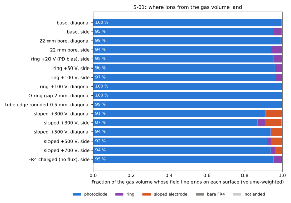
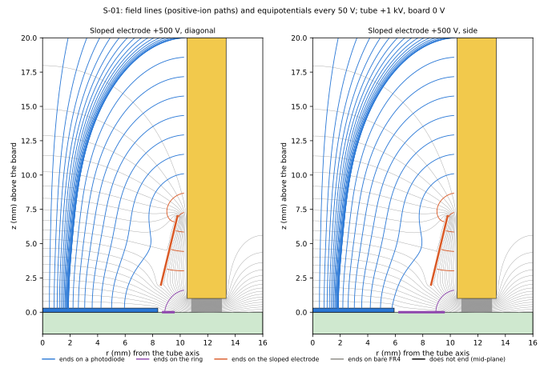
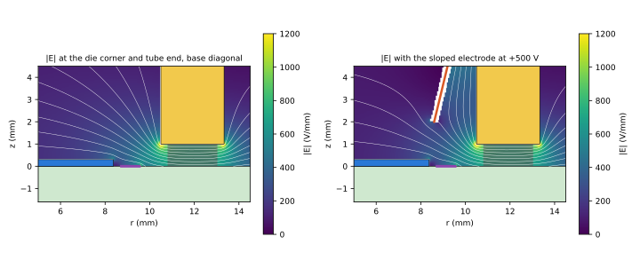
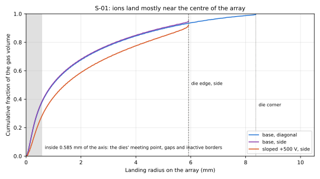
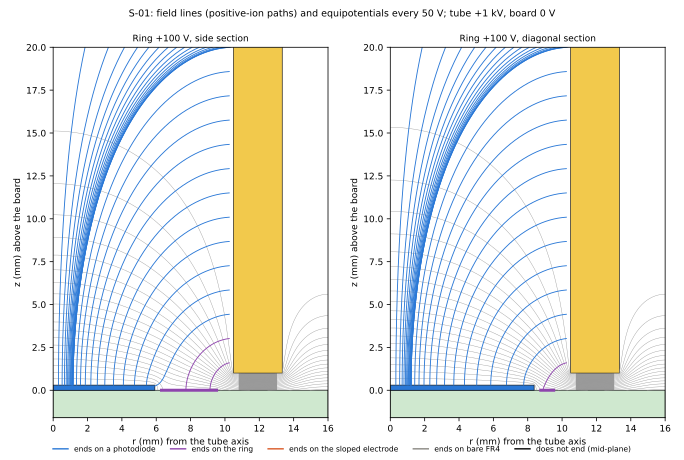

# S-01: electrostatic field of the Part 1 chamber end, and where the ions land

**Answer.** With the tube at +1 kV and the board at 0 V, the field line from 95–99 % of the gas volume ends on the photodiode array: the board is the only low-potential surface, so it collects almost everything. The 2.1–2.6 mm die-to-wall gap is acceptable: the field there is 0.3–0.7 kV/mm, and the highest field, about 1.5 kV/mm, sits on the tube end's sharp inner edge (about 1.2 kV/mm once that edge is rounded to 0.5 mm), against roughly 3 kV/mm for air at 1 atm. The sloped electrode does not help: at +300 to +700 V it intercepts 4–9 % of the ions and gives nothing back. A ring at +20 to +100 V gains 0.4–1.6 points. The new finding: ions from the upper two-thirds of the half-tube are funnelled toward the axis and land near the centre of the array, where the four dies meet, so about two-thirds of them land on gaps and inactive borders (estimate, below).

| | |
|---|---|
| ID | S-01 |
| Addresses | R-47 (ion steering), R-38 and R-75 (spacing, breakdown margin), R-43, A-10 and Q-24 (ring bias), review question 6 (die-to-wall gap), the collection efficiency in `docs/notes/chamber-sensitivity.md` |
| Method | Axisymmetric (r, z) Laplace, finite volume on a uniform grid, FR4 as a dielectric, direct sparse solve (scipy). Field lines traced along +E (RK2) from volume-weighted start points |
| Run | `.venv/bin/python sim/field/S-01-chamber/verify.py`, then `run.py` (about 4 minutes on the Intel Mac). Venv: repo root `MACHINES.md` |
| Outputs | `results/summary.md` (all cases), `results/results.json`, `results/run.out.txt`, `results/verify.out.txt`, six SVG plots |

## Model

| Quantity | Value | Source |
|---|---|---|
| Bore | 21 mm (22 mm as a case) | R-39 |
| Tube OD | 26.67 mm | 3/4 in NPS, ASME B36.10M |
| Tube wall | +1000 V | R-18, about +1 kV, `VERIFY` the final value |
| Boards apart | 76 mm, so a symmetry plane at 38 mm | A-23 |
| Tube end above the board (compressed O-ring) | 1.0 mm (2.0 mm as a case) | `VERIFY`, Q-20 open |
| Die | 5.67 × 5.67 × 0.30 mm, 5 × 5 mm active | VTH2110.json p1 |
| Array | 2 × 2 with 0.5 mm gaps: half-width 5.92 mm, corner radius 8.37 mm | A-02 |
| Die front | 0 V (CSA input) | A-05; at +20 V the result barely changes against 1 kV |
| Ring | Exposed copper from 0.3 mm outside the die to r = 9.6 mm, 0 V in the base case | A-10, Claude's layout assumption |
| Board | FR4, 1.6 mm, εr 4.4, back copper at 0 V | Typical values, `VERIFY` |
| Sloped electrode | A 0.3 mm conical sheet from (8.6, 2.0) to (9.8, 7.0) mm, at +300, +500, +700 V | The user's idea; Claude's geometry |
| Ion mobility | 2 cm²/(V·s) | Order of small air ions, `VERIFY` (transit times only) |
| Gas flow | 1 L/min through the bore: 48 mm/s | `docs/notes/gas-train.md` |

**Two sections bound the square array.** The model is axisymmetric, the array is square. The diagonal section (array as a disk of 8.37 mm radius) has the closest approach to the wall, the side section (5.92 mm) has the most board between die and wall. Real collection lies between them.

**Field lines are the ion paths here.** A Po-218 ion drifts at its mobility times the field: about 0.2 m/s at 1 V/mm, so in milliseconds, too slowly for inertia to matter. Thermal diffusion spreads an ion by about $\sqrt{2kT/(eV)}$ of its path, about 0.7 % across 1 kV (Einstein relation). So ions follow field lines, except where gas flow is faster than the drift (below).

## Checks

| Check | Result |
|---|---|
| Coaxial cylinders, $V(r) = V_0 \ln(b/r)/\ln(b/a)$ | Within 0.008 % (h = 0.1 mm) and 0.002 % (0.05 mm) |
| Parallel plates with an FR4 layer, $E = V_0/(d_2 + d_1/\varepsilon_r)$ | 1.1 % low at h = 0.1 mm, 0.6 % at 0.05 mm (first order: the interface falls on a node row) |
| Grid study, base case at h = 0.1, 0.05, 0.025 mm | Fractions converged: 99.2, 99.5, 99.6 % to the diodes, 67 % in the central cross at all three. Peak fields at sharp corners grow without limit as the grid refines, as they should: 1.24, 1.55, 1.93 kV/mm |

Sharp 90° corners (tube end, die edge) are singular in an ideal model, so their peak field depends on the grid. Read the sharp-corner numbers as "a little under 2 kV/mm at 25 µm"; the rounded-edge case converges (1.15 and 1.24 kV/mm at 0.05 and 0.025 mm).

## Results

Fractions are of the gas volume in the half-tube, weighted by volume. "Dead cross" is the share of ions landing on the array that fall within 0.585 mm of the two lines where the dies meet (half the 0.5 mm gap plus the 0.335 mm inactive border), averaged around the axis.

| Case | To photodiodes | Ring | Sloped electrode | Peak E (V/mm), where | Near die corner | Board at O-ring land (tangential) | Dead cross |
|---|---|---|---|---|---|---|---|
| Base, diagonal | 99.5 % | 0.4 % | | 1548, tube inner edge | 595 | 735 (416) | 67 % |
| Base, side | 95.0 % | 4.7 % | | 1539, tube inner edge | 323 | 735 (418) | 70 % |
| 22 mm bore, diagonal | 99.1 % | 0.7 % | | 1499 | 508 | 731 (344) | 64 % |
| 22 mm bore, side | 94.0 % | 6.0 % | | 1494 | 298 | 731 (347) | 68 % |
| Ring +20 V (PD bias), side | 95.4 % | 4.3 % | | 1524 | 356 | 734 (380) | 70 % |
| Ring +100 V, side | 96.6 % | 3.3 % | | 1464 | 486 | 732 (229) | 69 % |
| Ring +100 V, diagonal | 99.7 % | 0.2 % | | 1486 | 725 | 732 (215) | 67 % |
| O-ring gap 2 mm, diagonal | 99.8 % | 0.1 % | | 1021 | 496 | 423 (244) | 67 % |
| Tube edges rounded 0.5 mm, diagonal | 99.4 % | 0.4 % | | 1145, outer edge | 578 | 731 (388) | 67 % |
| Sloped +300 V, side | 86.8 % | 3.9 % | 8.9 % | 2124, top of the sloped sheet | 174 | 735 (403) | 60 % |
| Sloped +500 V, side | 91.7 % | 2.1 % | 6.0 % | 1565 | 248 | 735 (412) | 63 % |
| Sloped +700 V, side | 93.8 % | 2.3 % | 3.8 % | 1525 | 323 | 735 (421) | 67 % |
| FR4 fully charged, side | 95.3 % | 4.6 % | | 2176, ring's outer edge | 333 | 1566 (1332) | 70 % |

All cases at h = 0.05 mm; full table with transit times in `results/summary.md`.

### What it means

1. **Collection:** 95–99 % of field lines end on the array, without help. The ring and the sloped electrode only redistribute the last few per cent near the wall.
2. **Sloped electrode:** not adopted. Lines from the wall end on it whatever its voltage between the wall and the board, so it takes ions away from the diodes (4–9 %). It also adds the highest field in the model at its top edge at +300 V.
3. **Ring bias (Q-24, settled):** slightly positive helps, a little: +20 V gains 0.4 points, +100 V 1.6 points (side section), nothing on the diagonal. Adopted: tie the ring to the filtered +20 V PD bias. A separate +100 V rail is not worth 1.2 points.
4. **Die-to-wall gap (review question 6, settled):** acceptable at 2.1–2.6 mm. The die corner sees 0.3–0.7 kV/mm. The limit is the tube end's edges: about 1.5–1.9 kV/mm sharp, 1.2 kV/mm with a 0.5 mm radius, 1.0 kV/mm with a 2 mm O-ring gap. Against roughly 3 kV/mm for air at 1 atm in a uniform field (textbook value, `VERIFY`), that is a margin of about 2.5 with rounded edges. Breakdown field falls roughly with pressure, so R-43 (no HV below ambient) stays. Machining note: break both edges of each tube end to about 0.5 mm radius.
5. **Board at the O-ring land (Q-12):** 0.73–0.80 kV/mm, 0.2–0.6 kV/mm along the surface. If the bare FR4 charges up, the field moves to the ring's outer copper edge, up to 1.3 kV/mm along the surface (bound case). The 5.0 mm rule (R-75) cannot hold inside the chamber, where the ring copper sits about 1 mm from the tube end. The chamber is closed and dry, so the inside is judged by field, not by IPC-2221: keep the ring's outer edge at least 0.9 mm inside the bore, solder-mask or round its edge, and keep any 0 V copper outside the O-ring off the chamber side.
6. **Where they land:** far from the board, the field is weak and its radial part keeps pushing ions toward the axis; ions from the upper part of the half-tube land within 1–2 mm of the centre. About two-thirds of landings fall in the band where the dies meet (estimated by averaging the axisymmetric landing radius around the axis; a 3D model would refine it). Both boards in a chamber see the same, so the comparison (R-53) is unaffected; the cost is count rate. Written up as a question.
7. **Efficiency for the count-rate note:** about 0.97 collected × 0.33 off the dead cross × 0.5 emitted into the die gives about 16 % per alpha, before neutralisation and recoil losses (not modelled, `VERIFY`). That sits inside the 10–25 % guessed in `chamber-sensitivity.md`.
8. **Transit:** median 4–7 ms at 2 cm²/(V·s), against Po-218's 186 s half-life. In the middle fifth of the tube (16–20 % of the volume) the field is so weak that a 1 L/min flow outruns the drift: in flow-through runs those ions are swept downstream, in static runs (R-31) they are collected.

## Expected results (for the test plan)

| Measurement | Expected | From |
|---|---|---|
| Count rate, static run, both boards | Equal within statistics | Collection is symmetric, R-53 |
| Count rate, flow-through against static, same radon level | Lower in flow, by up to about a fifth | Point 8 |
| Spectrum with the ring at 0 V against +20 V | No visible difference | Point 3 |
| Discharge or leakage spikes at 1 kV, chamber at ambient | None | Point 4 |

## Not captured

- 3D shape of the square array: two axisymmetric sections bound it; the dead-cross share is an azimuthal average.
- Surface charging of bare FR4 and the O-ring: two bounds only (uncharged dielectric, fully charged).
- Ion neutralisation, recoil, plate-out by diffusion near the mid-plane, space charge: none modelled.
- Gas flow pattern: compared by speed only.
- The O-ring's permittivity, the gas-port holes and fittings, the enclosure outside the tube (outer boundary: zero normal field at r = 16 mm).
- Breakdown itself: fields only. Streamer and Paschen criteria, and surface flashover along FR4, are not computed.
