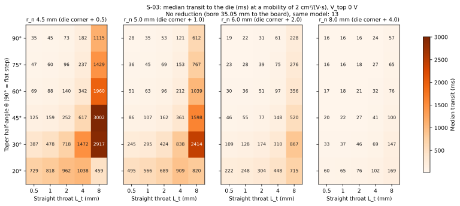
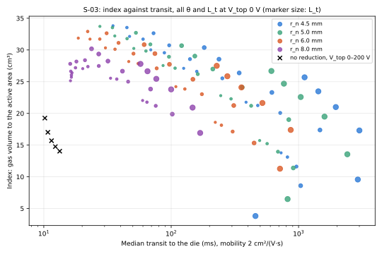

# S-03: aluminium tube with a reduced end over one photodiode

**Answer.** Reduce the bore over the die with a **flat step, not a taper**: a lip at +1 kV whose hole clears the die's corner by about 1 mm ($r_n$ = 5.0 mm), with the shortest straight throat that can be machined (0.5–1 mm). Leave the exposed board at **0 V**: no top-copper bias. Then 99 % of the gas volume's field lines end on the active area. The index (the gas volume whose ions reach the active area) is 33.5–33.8 cm³ per detector, against 20.4 cm³ at S-02's build point (1-1/4 in pipe, top copper at +200 V). That is 1.65 times more, with no bias supply. A taper does worse at every angle: it removes gas and deepens the shielded throat, so ions arrive more slowly (at $r_n$ 5.0 and $L_t$ 0.5: 1.5 cm³ less index at 75°, 6.2 cm³ at 45°, 18 cm³ at 20°). A longer throat also costs: past 2 mm, index falls and transit rises fast. The price of the narrow mouth is transit time: a median of 28–35 ms and a 90th percentile of 0.25–0.31 s, against 13 and 42 ms unreduced. Measured neutralisation rates (charged life 11–70 s in air) make that loss about 1 % in dried gas ([decay-chain note](../../../docs/notes/radon-chain-for-the-detector.md)). Peak gas field 1.23 kV/mm at the lip's edge (50 µm grid), against about 3 kV/mm for air.

| | |
|---|---|
| ID | S-03 |
| Addresses | A-29 (one detector per tube), the user's proposal of 2026-11-22: thick-walled aluminium tube, reduced end machined from bar and bolted on axially, taper lead-in, modest or zero bias. Parameters named by the user: bias, taper angle, throat length |
| Method | S-01's axisymmetric Laplace solver (`../S-01-chamber/field.py`), unchanged; S-02's die model, start-point weighting and active-area share. Two unit solves per geometry (tube at 1 V, copper at 1 V), combined for each $V_{top}$ |
| Sketch | [arrangement.svg](arrangement.svg) from `sketch.py`, confirmed by the user before the sweep |
| Run | `.venv/bin/python sim/field/S-03-reduced-end/run.py` (121 geometries × 5 biases, about 15 minutes on the Intel Mac), then `points.py` (4 geometries at h = 0.05 mm with the die's three sections, about 4 minutes). `run.py --plots` redraws from `sweep.json` |
| Outputs | `results/summary.md` (all 605 points), `sweep.json`, `points.json`, `plates.json`, `run.out.txt`, `points.out.txt`, `plates.out.txt`, `run-lt1.out.txt` (first pass, L_t fixed at 1 mm), four SVG plots |

![General arrangement: full section of the thick-walled aluminium tube, ID 35.05 mm, OD 2 in, at +1 kV, with an end piece from bar bolted on axially. The end piece reduces the bore to radius r_n over the VTH2110 with a straight throat L_t and a taper at half-angle theta up to the main bore. It stands on a 1 mm PTFE washer on the detector board. A detail shows the die at 0 V and the exposed board copper inside r_n, and a top view shows the round bore modelled against the optional rounded-square loft.](arrangement.svg)

## Model

| Quantity | Value | Source |
|---|---|---|
| Main bore | 35.05 mm ID (1-1/4 in sch 40, as S-02), +1 kV | The user: "in line with our 1.25 NPT size" |
| Tube and bar OD | 2 in (50.8 mm); outside the field region | `VERIFY` stock size |
| End piece | Same conductor as the tube (bolted metal to metal). Bore $r_n$ for a straight throat $L_t$ above the washer, then a taper at half-angle θ up to the main bore. θ = 90° is a flat step | The user |
| $r_n$ | Die corner (4.01 mm) + 0.5, 1, 2, 4 mm: 4.5, 5.0, 6.0, 8.0 mm; 17.5 mm (no reduction) as the reference | Clearance chosen here |
| θ | 20, 30, 45, 60, 75, 90° | 20° reaches the main bore only about 36 mm up, so it is close to the longest taper that fits |
| $L_t$ | 0.5, 1, 2, 4, 8 mm. 0.5 mm is the 0.5 mm edge radius alone | The user asked for it to vary |
| Throat's lower inner edge | 0.5 mm radius | As S-02 |
| Washer | 1.0 mm PTFE, modelled as gas (S-02); start points in its gap (r > $r_n$, z < 1 mm) are left out | A-23, `VERIFY` |
| Exposed copper | From 0.3 mm outside the die to 0.3 mm inside $r_n$, at $V_{top}$ = 0, 20, 50, 100, 200 V | S-02's clearance; the user: modest or zero bias |
| Die, board, symmetry plane at 38 mm, grid h = 0.1 mm, mobility 2 cm²/(V·s) | As S-02 | S-02 |
| Index | Gas volume per detector (cm³) whose field line ends on the active area: start-point volumes times active-area share. Same quantity as S-02's "per detector" column | S-02 |

## Checks

| Check | Result |
|---|---|
| Reference against S-02 | No reduction, 200 V: 54.9 % to the active area, index 19.3 cm³. S-02's 1-1/4 in sch 40 at 200 V: 55.5 %, 20.4 cm³. The 1 cm³ difference is the washer gap, left out here |
| Grid, four points | Share at h = 0.1 and 0.05 mm within 0.4 points; index within 0.2 cm³; transit within 5 % |
| Square die | Side and diagonal sections bracket the equal-area disk: 99.2–99.4 % at the best point, 97.3–98.1 % at $r_n$ 6.0 |
| Superposition | Exact for Laplace with fixed conductors |

## Results

### Selected points ($V_{top}$ = 0 V, h = 0.05 mm, equal-area die)

| Geometry | To active area | Index (cm³) | Median transit (ms) | 90 % transit (ms) | Peak gas field (kV/mm), where |
|---|---|---|---|---|---|
| **Flat step, $r_n$ 5.0, $L_t$ 0.5** | **99.4 %** | **33.8** | **29** | **265** | **1.23, lip edge** |
| Flat step, $r_n$ 5.0, $L_t$ 1.0 (h = 0.1) | 99.4 % | 33.5 | 35 | 309 | 1.00 at h = 0.1 |
| Flat step, $r_n$ 6.0, $L_t$ 1.0 | 97.8 % | 33.0 | 23 | 206 | 1.22, lip edge |
| As sketched: θ 45°, $r_n$ 5.0, $L_t$ 1.0 | 99.4 % | 27.3 | 111 | 700 | 1.21, lip edge |
| No reduction | 40.1 % | 14.1 | 13 | 43 | 1.15, tube edge |
| S-02 build point (+200 V on copper) | 55.5 % | 20.4 | 7 | – | 1.01, tube edge; 0.85 at the copper |

### What it means

1. **Shape:** a flat step beats every taper. The ions are already funnelled by the field. A cone only puts +1 kV metal nearer the axis, removing gas and shielding the die further.
2. **Throat:** keep it short. At $r_n$ 5.0 and θ 90°, $L_t$ 0.5 → 1 → 2 → 4 → 8 mm gives index 33.7, 33.5, 32.7, 30.7, 26.7 cm³ and median transit 28, 35, 53, 121, 612 ms. The die's potential fades inside a narrow bore within a few mm. 1–2 mm costs little and may be easier to make and stiffer than 0.5 mm.
3. **Mouth size:** $r_n$ 4.5–5.0 gives the highest index. At 6.0 the index drops 2 % and transit drops by a third. At 8.0 the board around the die starts to take ions (74 % to the active area at 0 V).
4. **Bias:** at $r_n$ ≤ 6 mm, $V_{top}$ changes the share by under 1 point, so a 0 V exposed board loses nothing. The copper inside the mouth then serves as the 0 V guard (A-11). Only at $r_n$ 8 does 200 V add 9 points.
5. **Machining:** the result is a short tube section with an inward lip at its end, the lip about 1 mm thick with a 10 mm hole. The rounded-square loft is not needed for the field. A rounded-square hole hugging the die (1 mm clearance on the sides) would sit between the side and diagonal sections, which agree within 0.2 points.
6. **Neutralisation:** at 2 cm²/(V·s), 90 % of ions arrive within 0.27 s. If the clusters' mobility is 0.7 (the low end), that is 0.76 s. At measured rates this loses 0.4–1.1 % in dry air and 2–6 % at 50 % RH. The sketched 45° taper would lose up to 14 % at 50 % RH.
7. **Fields:** the lip's edge sits 1 mm over the 0 V board, as the tube's end did in S-02, so the gas field there is the same, about 1.2 kV/mm at 50 µm. With no copper bias, S-02's 0.85 kV/mm copper-edge field and its leakage path into the CSA disappear.

## Thin plates (the user's construction, 2026-11-22)

The user chose a thin flat plate: waterjet-cut aluminium about 1.5 mm thick, or a laser-cut stainless stencil ordered with the PCBs. Both are 2D cuts, so the hole can be the rounded square at no cost. `plates.py`, $V_{top}$ 0, finest grid shown:

| Plate | $r_n$ | To active area | Index (cm³) | Median / 90 % transit (ms) | Peak gas field at the hole edge |
|---|---|---|---|---|---|
| **Aluminium 1.5 mm, 0.5 mm edge radius** | **5.0** | **99.6 %** | **33.1** | **45 / 396** | **1.21 kV/mm (h 0.05)** |
| Aluminium 1.5 mm | 6.0 | 98.8 % | 32.9 | 28 / 240 | 1.22 kV/mm |
| Stencil 0.13 mm (`VERIFY` thickness), 0.05 mm edge radius | 5.0 | 99.0 % | 34.2 | 25 / 238 | 2.0 kV/mm (h 0.025), still rising with refinement |
| Stencil 0.13 mm | 6.0 | 91.2 % | 31.5 | 17 / 160 | 2.0 kV/mm |

- Both score within 3 % of each other. Recommended: aluminium 1.5 mm, hole about 1 mm clear of the die (round 10 mm, or the rounded square), its board-side edge deburred to a radius.
- The stencil's sharp edge doubles the local field. The whole 1 mm gap still holds only 1 kV, well under air's breakdown voltage for 1 mm, roughly 4 kV (Paschen, `VERIFY`). So this is a margin to watch (burrs, flatness of a 0.13 mm foil 1 mm over the board) rather than a stop.
- A thin stencil shields less, so a wider stencil hole sends ions to the board around the die (91 % at $r_n$ 6). Keep its hole tight.

## Expected results (for the test plan)

| Measurement | Expected | From |
|---|---|---|
| Count rate, flat-step end ($r_n$ 5, $L_t$ ≤ 1) against the unreduced tube, both at 0 V, same radon | About 2.4 times higher | Point 4 (33.7 / 14.0) |
| Count rate against S-02's build point (+200 V copper) | About 1.65 times higher | Point 1 |
| Count rate against tube voltage, 0.5–1.5 kV | Flat once ions arrive well within their charged life; a fall at low voltage shows neutralisation | Point 6 |
| Count rate, dry against humid gas | A few per cent lower when humid | Point 6 |

## Not captured

- The square die in 3D, and the rounded-square loft: bracketed by the side and diagonal sections only.
- Neutralisation, recoil and diffusion are not in the field model. Their effect is estimated from the transit times and the decay-chain note.
- Ion mobility is fixed at 2 cm²/(V·s). Transit scales inversely with it.
- PTFE washer and bare FR4: modelled as gas; surface charge ignored.
- Seals, bolts, the tube length beyond 76 mm, gas ports.
